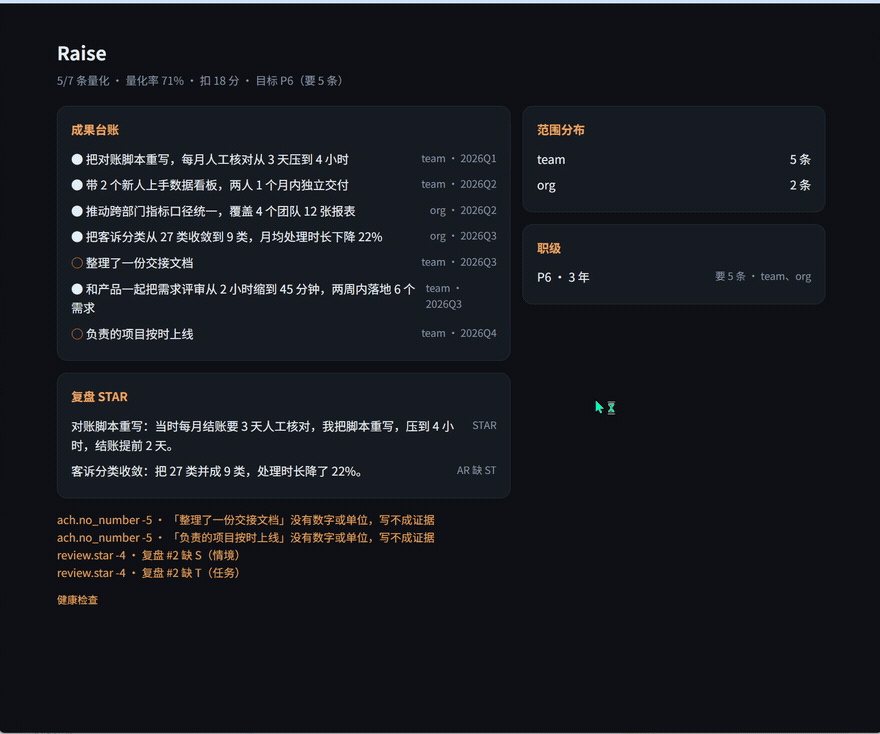
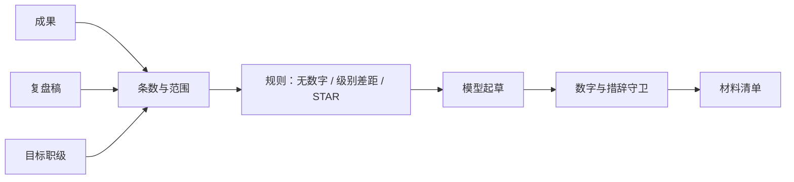

# Raise · promotion packet

[](https://github.com/wushiyi105-jpg/raise/actions)

[](./LICENSE)



Three gates before the packet: numbers in your achievements, level fit, STAR completeness — then a guard on the salary script.

## Features

- Treats an achievement as quantified only when it contains a number with a unit.
- Counts quantified and cross-team items against the target level.
- Names the missing STAR segment in each review draft.
- Drops numbers not found in the evidence, and phrases such as “the only one” or “irreplaceable”.

Rules live in `raiseup/domain/rules/`; the CLI and the web layer only call them. The Chinese README lists every `rule_id` with its penalty.

## Quickstart

```bash
pip install -e ".[dev]"
python -m raiseup seed
python -m raiseup readiness --level P6
python -m raiseup check --text "我把结账时间压到 4 小时，效率提升 37%"
python -m raiseup serve        # http://127.0.0.1:8007
```

Run `python -m raiseup --help` for the full command list; `docker build -t raise . && docker run -p 8007:8007 raise` works the same way.

## Why not just ask a general LLM

A model loves “significant improvement” and “major optimisation”, which reviewers discount immediately. Raise marks each item as quantified or not, counts against the target level and checks the script against evidence.

## When to use it

- Promotion season and your year’s work needs to become a packet.
- You drafted a salary conversation and want a fact check first.

## Roadmap

- Import the level requirements from your company’s ladder.
- Add a mock review round with follow-up questions.

## FAQ

**Who assigns the impact score?**
You do; the tool only sorts by it.

**What if an achievement has no number?**
It is flagged and scored down; the tool never invents one.

## Commands

See the Chinese README (`README.md`) for the command table with flags; every command supports `--help`.

## Dependencies

FastAPI + Uvicorn, Jinja2, pydantic / pydantic-settings, httpx, Typer + Rich, SQLAlchemy + Alembic; dev extras add pytest, pytest-cov, respx, freezegun, ruff, mypy, pip-audit. Version pinning lives in `uv.lock`.

## How it works



## Layout

```
raise/
├── .github/
│   ├── ISSUE_TEMPLATE
│   ├── PULL_REQUEST_TEMPLATE.md
│   └── workflows
├── assets/
│   └── demo.gif
├── data/
│   ├── raise.db
│   ├── raiseup.db
│   └── seed.json
├── migrations/
│   ├── __init__.py
│   ├── env.py
│   ├── script.py.mako
│   └── versions
├── prompts/
│   └── material.md
├── raiseup/
│   └── … 9 项
├── templates/
│   └── index.html
├── tests/
│   ├── __init__.py
│   ├── conftest.py
│   ├── test_cli_doctor.py
│   ├── test_engine_web.py
│   ├── test_quantify_level.py
│   └── test_star_guard.py
├── CHANGELOG.md
├── CODE_OF_CONDUCT.md
├── CONTRIBUTING.md
├── Dockerfile
├── LICENSE
├── README.en.md
├── README.md
├── SECURITY.md
├── alembic.ini
├── pyproject.toml
```

## Author

shiyi · GitHub [@wushiyi105-jpg](https://github.com/wushiyi105-jpg) · wushiyi105@gmail.com
