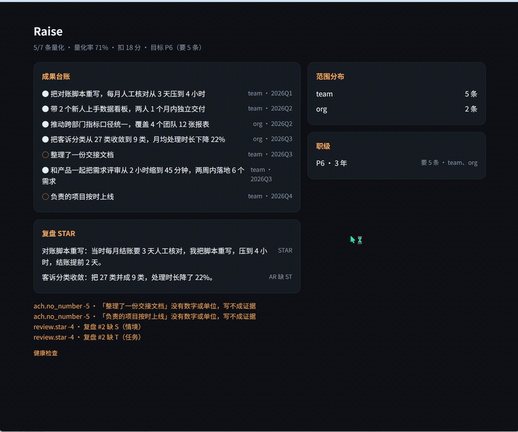

# Raise · 晋升材料

[](https://github.com/wushiyi105-jpg/raise/actions)

[](./LICENSE)



晋升材料先过三道闸：成果有没有数字、够不够目标 P 级、复盘 STAR 齐不齐；谈薪稿再过一个守卫：不许编数。

## 为什么不是让模型写一份

模型很会写「显著提升」「大幅优化」，评审看一眼就放下了。Raise 把每条成果标成「有数字带单位 / 没有」，
按目标 P 级要几条、要不要跨团队范围逐条数；复盘缺哪段 STAR 直接点名；谈薪稿里出现证据里没有的数字，
或者「唯一」「不可替代」这类话，一律删掉重写。

## 它做什么

1. **量化识别**：数字 + 单位（% / 万 / 元 / 人 / 天 / 小时 / 次…）才算证据。
2. **职级对齐**：目标 P 级要几条量化成果、要几条跨团队范围。
3. **STAR 完整度**：S/T/A/R 缺哪段点名。
4. **谈薪稿守卫**：数字必须能在成果里找到，禁「唯一/第一/不可替代」。
5. **台账**：按影响分排序，取前几条当主线。

## 怎么用

```bash
pip install -e ".[dev]"
python -m raiseup seed
python -m raiseup readiness --level P6
python -m raiseup check --text "我把结账时间压到 4 小时，效率提升 37%"
python -m raiseup serve        # http://127.0.0.1:8007
```

包名是 `raiseup`，因为 `raise` 是 Python 关键字，不能直接 `import raise`；仓库名仍是 raise。

真实种子：7 条成果（5 条带数字，2 条是「整理了一份交接文档」「负责的项目按时上线」）、目标 P6
要 5 条量化且 team/org 各 2 条、2 份复盘（第二份只有 A/R）。

`readiness --level P6` 出来：量化 5/7（71%），team 5 条、org 2 条，P6 的条数与范围都够，不报 `level.gap`；
两条没数字的成果各扣 5；第二份复盘缺 S 和 T 各扣 4，合计 18 分。
`check --text "…效率提升 37%"` 会指出 37 在证据里找不到。

## 规则与扣分

| rule_id | 含义 | 扣分 |
| --- | --- | --- |
| `ach.no_number` | 成果没有数字或单位 | 5 |
| `level.gap` | 量化条数或范围不够目标 P 级 | 6 |
| `review.star` | 复盘缺 STAR 某段 | 4 |
| `guard.number` | 稿里出现证据没有的数 | 8 |
| `guard.claim` | 写了「唯一/第一」这类话 | 6 |

## 边界

- 不判断公司有没有 HC，只看材料本身；
- 影响分是自己打的，不是模型给的；
- 谈薪幅度不给建议，只检查数字来源。

## 作者

shiyi · GitHub [@wushiyi105-jpg](https://github.com/wushiyi105-jpg) · wushiyi105@gmail.com
