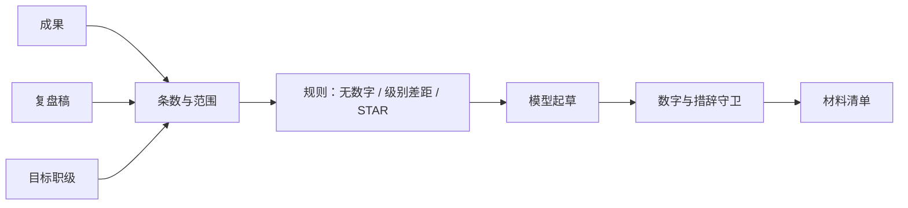

# Raise · 晋升材料

[](https://github.com/wushiyi105-jpg/raise/actions)

[](./LICENSE)


晋升材料先过三道闸：成果有没有数字、够不够目标 P 级、复盘 STAR 齐不齐；谈薪稿再过一个守卫：不许编数。


## 功能特性

1. **量化识别**：数字 + 单位（% / 万 / 元 / 人 / 天 / 小时 / 次…）才算证据。
2. **职级对齐**：目标 P 级要几条量化成果、要几条跨团队范围。
3. **STAR 完整度**：S/T/A/R 缺哪段点名。
4. **谈薪稿守卫**：数字必须能在成果里找到，禁「唯一/第一/不可替代」。
5. **台账**：按影响分排序，取前几条当主线。

### 规则与扣分

| rule_id | 含义 | 扣分 |
| --- | --- | --- |
| `ach.no_number` | 成果没有数字或单位 | 5 |
| `level.gap` | 量化条数或范围不够目标 P 级 | 6 |
| `review.star` | 复盘缺 STAR 某段 | 4 |
| `guard.number` | 稿里出现证据没有的数 | 8 |
| `guard.claim` | 写了「唯一/第一」这类话 | 6 |

## 快速开始

```bash
pip install -e ".[dev]"
python -m raiseup seed
python -m raiseup readiness --level P6
python -m raiseup check --text "我把结账时间压到 4 小时，效率提升 37%"
python -m raiseup serve        # http://127.0.0.1:8007
```

包名是 `raiseup`，因为 `raise` 是 Python 关键字，不能直接 `import raise`；仓库名仍是 raise。

真实种子：7 条成果（5 条带数字，2 条是「整理了一份交接文档」「负责的项目按时上线」）、目标 P6
要 5 条量化且 team/org 各 2 条、2 份复盘（第二份只有 A/R）。

`readiness --level P6` 出来：量化 5/7（71%），team 5 条、org 2 条，P6 的条数与范围都够，不报 `level.gap`；
两条没数字的成果各扣 5；第二份复盘缺 S 和 T 各扣 4，合计 18 分。
`check --text "…效率提升 37%"` 会指出 37 在证据里找不到。

## 为什么不用通用大模型直接问

模型很会写「显著提升」「大幅优化」，评审看一眼就放下了。Raise 把每条成果标成「有数字带单位 / 没有」，
按目标 P 级要几条、要不要跨团队范围逐条数；复盘缺哪段 STAR 直接点名；谈薪稿里出现证据里没有的数字，
或者「唯一」「不可替代」这类话，一律删掉重写。

## 适用场景

- 晋升季要把一年的成果整理成评审能看的材料。
- 自评写不出数字，需要有人指出哪几条没有证据。
- 谈薪稿想先自查一遍，别写出编造的数字。

### 边界

- 不判断公司有没有 HC，只看材料本身；
- 影响分是自己打的，不是模型给的；
- 谈薪幅度不给建议，只检查数字来源。

## Roadmap

- 按公司职级表导入要求条数与范围。
- STAR 缺段时给出补问清单。
- 多轮评审模拟，提前适应追问。

## FAQ

**影响分谁打？**
自己打，工具只按分数排序。

**没有数字的成果会怎样？**
标 `ach.no_number` 并扣分，不替它编数。

**哪些词会被拦？**
「唯一 / 第一 / 不可替代」这类，以及证据里找不到的数字。

**Docker 镜像验证了吗？**
CI 的 `docker` job 每次执行 `docker build .`，启动容器并轮询 `/health`；本机没有 Docker，本地未重复跑。

## 命令参考

| 命令 | 作用 | 常用参数 |
| --- | --- | --- |
| `seed` | 写入成果、职级、复盘稿。 | --db |
| `readiness` | 量化率、职级差距、复盘完整度。 | --level, --db |
| `draft` | 模型起草（无 key 时不编）。 | --level, --db |
| `check` | 检查稿子里的数字与措辞。 | --text, --db |
| `doctor` | 四项体检。 | --db |
| `serve` | Web 界面。 | --port, --db |

全部命令都支持 `--help`；只读命令不带参数时读默认库 `data/raise.db`，写命令用 `--db` 指到别的库。

## 依赖说明

| 依赖 | 为什么装 | 不装会怎样 |
| --- | --- | --- |
| `fastapi` + `uvicorn[standard]` | Web 入口与 ASGI 服务 | 只有命令行，没有页面 |
| `jinja2` | 服务端渲染模板 | 页面出不来 |
| `pydantic` + `pydantic-settings` | 配置与数据结构校验，`.env` 直接生效 | 配置散在代码里，改端口要改源码 |
| `httpx` | 调模型与 webhook 的 HTTP 客户端 | 模型层与推送都不可用 |
| `typer` + `rich` | 命令行与终端表格 | 只能用 curl 调接口 |
| `sqlalchemy` + `alembic` | 本地库与迁移 | 表结构变更只能删库重来 |
| `pytest` / `pytest-cov` / `respx` / `freezegun`（dev） | 单测、覆盖率、HTTP 打桩、冻结时间 | 规则改动没有回归保护 |
| `ruff` / `mypy` / `pip-audit`（dev） | 风格、类型、依赖漏洞检查 | CI 只看测试，类型错误会漏进主干 |

装了 `uv` 的话，`uv sync --extra dev` 会按 `uv.lock` 装同一套版本。

## 工作原理




domain 里是量化识别、职级对齐、STAR 与两道守卫；app 负责材料清单。

## 目录结构

```
raise/
├── .github/
│   ├── ISSUE_TEMPLATE
│   ├── PULL_REQUEST_TEMPLATE.md
│   └── workflows
├── assets/
│   └── demo.gif
├── data/
│   ├── raise.db
│   ├── raiseup.db
│   └── seed.json
├── migrations/
│   ├── __init__.py
│   ├── env.py
│   ├── script.py.mako
│   └── versions
├── prompts/
│   └── material.md
├── raiseup/
│   └── … 9 项
├── templates/
│   └── index.html
├── tests/
│   ├── __init__.py
│   ├── conftest.py
│   ├── test_cli_doctor.py
│   ├── test_engine_web.py
│   ├── test_quantify_level.py
│   └── test_star_guard.py
├── CHANGELOG.md
├── CODE_OF_CONDUCT.md
├── CONTRIBUTING.md
├── Dockerfile
├── LICENSE
├── README.en.md
├── README.md
├── SECURITY.md
├── alembic.ini
├── pyproject.toml
```

## 质量与供应链

- CI 的 Coverage 步骤带 `--fail-under=70`，覆盖率低于 70% 直接失败。
- `tests/test_app_fake.py` 用真实 `InMemoryStore` 跑主用例，并显式标注 `StorePort` 交给 mypy 做结构校验；测试不创建 SQLite 文件。
- Audit 步骤从 `uv.lock` 导出运行时依赖，再用 `pip-audit -r` 审计；开发工具链不进发布物，运行时依赖有漏洞就让 job 失败，不用 `|| true` 吞错。

## 容器验证

镜像由 CI 的 docker job 构建并探活验证；本机未装 Docker。

## 作者

小米 · GitHub [@wushiyi105-jpg](https://github.com/wushiyi105-jpg) · 17612850106